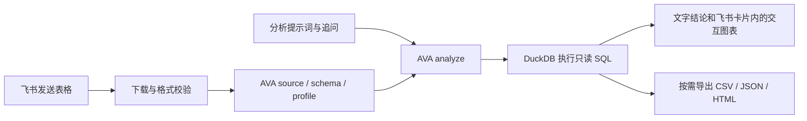

# AVA 飞书数据分析机器人

发送表格和分析要求，机器人通过 **AntV AVA 4.0.0 + DuckDB** 执行真实统计，把结论、关键依据、交互图表和一个具体的下一步问题放在同一张飞书卡片里。“分析一下”会主动分析整体表现、趋势和主要差异。支持同一份数据连续追问。

使用飞书官方 Node SDK 的 **WebSocket 长连接**，本地或服务器运行均可，不需要公网回调地址。需要创建有接收消息能力的「企业自建应用机器人」。



## 支持的数据

| 输入 | AVA 接口 | 说明 |
| --- | --- | --- |
| `.csv` / `.tsv` | `csv-file` | 第一行是表头；TSV 使用制表符 |
| `.json` | `json-file` | 推荐对象数组，字段名作为列名 |
| `.jsonl` / `.ndjson` | `json-file` | 每行一个 JSON 对象 |
| `.xlsx` | `excel` | 所有工作表分别加载，可按表名分析或关联 |
| `.parquet` | `parquet` | 保留文件中的类型信息 |
| `.txt` / `.md` | `text` | 由模型抽取结构化数据，最多 256 KB，UTF-8 编码 |
| `.sqlite` / `.sqlite3` / `.db` | `sqlite` | 只读加载 SQLite 中的表 |
| 飞书多维表格链接 | `feishu-bitable` | `/导入 https://企业.feishu.cn/base/...?...`；支持 wiki 中的多维表格 |

Excel 接口支持 `.xlsx`；旧 `.xls` 请先另存为 `.xlsx` 或 CSV。CSV/文本建议使用 UTF-8。Excel/SQLite 首次使用时，DuckDB 会下载官方扩展，运行环境需要能访问扩展服务器，且运行用户的主目录可写。

AVA 还支持 MySQL、PostgreSQL、MongoDB、Supabase、ClickHouse 等数据库连接；此机器人提供的是**文件上传和多维表格链接**入口，未开放在聊天中提交数据库连接凭据的功能。

## 本地启动

要求 macOS / Linux，Node.js **22.13 或以上**。

```bash
cd /Users/keikei/ava-feishu-bot
nvm use
npm ci
cp .env.example .env
```

在 `.env` 中填写：

```dotenv
FEISHU_APP_ID=你的飞书应用AppID
FEISHU_APP_SECRET=你的飞书应用AppSecret
LLM_API_KEY=你的模型APIKey
LLM_MODEL=你的模型标识
LLM_BASE_URL=https://模型供应商的兼容接口地址/v1
```

`LLM_BASE_URL` 填 API 根地址，AVA 会调用其 `/chat/completions`。填写模型供应商提供的地址和模型 ID；接口应支持 Chat Completions 和纯文本 JSON 输出。使用供应商默认地址时可按其配置要求留空。

然后运行：

```bash
npm run build
npm start
```

日志出现「长连接已连接」后可以接收消息。开发时使用 `npm run dev`；修改 TypeScript 后需要重新构建。

## 飞书开放平台配置

1. 打开 [飞书开发者后台](https://open.feishu.cn/app)，创建**企业自建应用**，添加「机器人」能力。复制 App ID 和 App Secret 到本地 `.env`。
2. 在「权限管理」开通以下**应用身份**权限。可以使用 [私聊权限 JSON](docs/feishu-permissions.json) 批量导入。

   | 权限 | 用途 |
   | --- | --- |
   | `im:message.p2p_msg:readonly` | 接收用户发给机器人的私聊消息和文件 |
   | `im:message:readonly` | 通过消息资源接口下载用户发来的附件 |
   | `im:message:send_as_bot` | 回复分析结果 |
   | `im:resource` | 上传分析结果附件等资源 |

   `im:message.p2p_msg:readonly` 控制私聊事件推送，`im:message:readonly` 控制通过消息资源 API 读取附件，`im:resource` 控制资源上传等操作。三者不能互相替代。如果能收到消息但附件下载提示 `99991672`，应根据返回的 `permission_violations` 核对具体缺失权限。

3. 启动本服务。在「事件与回调」中选择**使用长连接接收事件**，订阅 `im.message.receive_v1`（接收消息）。长连接模式下无需填写回调 URL、Verification Token 或 Encrypt Key。
4. 在「版本管理与发布」创建并发布版本，确认当前用户在应用可用范围内；按租户要求完成管理员审核。权限修改后也需要重新发布。
5. 在飞书中打开机器人私聊，先发送 [示例销售表](examples/sales.csv)，待收到「数据已就绪」后输入：`按地区汇总销售额，并画柱状图`。之后可以继续问：`只看华东，按月份比较`。

### 在群聊使用

将机器人加入群，并额外申请 `im:message.group_at_msg:readonly`。填写 `.env` 中的 `FEISHU_BOT_OPEN_ID`（`ou_` 开头），用于区分用户 @ 的是否为当前机器人。可在飞书 API 调试台调用「获取机器人信息」接口 `/open-apis/bot/v3/info`，读取 `bot.open_id`。

群聊中文件消息无法携带 @，因此要在群里直接发送文件，还需要开通 `im:message.group_msg`（接收群聊所有消息）并发布。如果暂时没有此权限，可以先在私聊上传并分析；或者在群里 @ 机器人，使用 `/导入` 读取多维表格链接。普通群聊文字只响应 @ 当前机器人的消息。

会话以「chat_id + 用户 open_id」隔离；群内另一人的提问不会读到你的数据，私聊与群聊也不共用上传文件。机器人在群内回复的分析结果对群成员可见。

### 读取飞书多维表格

在开发者后台开通应用身份权限 `bitable:app:readonly` 并发布。读取 wiki 链接时还需对应的知识库读取权限（如 `wiki:wiki:readonly`）。然后在表格的「更多 → 添加文档应用」中授权同一个应用。表格协作者权限与开放平台 API 权限分别生效；开启高级权限的表格还需要核对目标子表的读取范围。

可以把链接和分析要求放在同一条消息里，直接粘贴链接或发送带预览的多维表格卡片。例如：

```text
https://你的企业.feishu.cn/base/你的AppToken
分析一下
```

整份 Base 链接会导入所有数据表，概览按表给出发现。可以指定表名继续提问，也可以按可靠的关联键跨表计算。带 `table=` 的链接用于单独导入指定子表。只发链接或使用 `/导入 链接` 会先加载数据，再等待分析问题。

每张子表由 AVA 原生 `feishu-bitable` 读取器加载。多表快照使用 AVA 的 SQLite 数据源，首次使用需要下载 DuckDB 官方 SQLite 扩展。机器人需要能读取参与分析的各张表。请复制原表地址，发布分享链接（`/share/base/`）需换成原表地址。表格变化后可重新发送链接刷新快照。普通飞书电子表格可导出为 XLSX/CSV 后发送。

## 对话用法

```text
按地区汇总销售额，并画柱状图
哪些产品利润率最低？请说明计算口径
只看华东，再按月份比较
按舱位和性别交叉分组，比较人数和票价中位数，并说明年龄缺失的影响
/分析 不画图 列出销售额最高的前 10 条记录
/字段
/预览
/画像
/建议
/清空
```

`/状态` 显示当前文件和表信息；`/帮助` 查看用法。上传新文件成功后会替换本人的旧数据并清除追问上下文。导入失败会保留旧数据。Excel 多表可直接指定工作表名，例如 `关联“订单”和“客户”，按客户地区统计金额`。

私聊中也可以在同一条消息里附上一个文件并输入分析要求，例如「分析一下这个数据」+ `sales.csv`。机器人会先加载附件，再执行本条消息的分析要求。一次仅导入一个文件；多个工作表请放在同一个 XLSX 中。

默认回复是一张分析卡，包含结论、最多两条关键依据和一个有针对性的下一步问题。适合可视化的结果会直接在卡片里显示：例如按月份比较用折线图，按地区比较用条形图。图表使用 AVA 实际算出的数值，不展示原始行、SQL 或附件清单。单个数值或没有足够可比数据时直接用文字回答。临时关闭图表可在问题前加「不画图」；全局关闭可配置 `ENABLE_CHARTS=false`。

上传时带分析要求，只发送一条等待提示和一张分析卡；只上传文件时，提供简短的分析方向引导。卡片图表使用[飞书原生图表组件](https://open.feishu.cn/document/feishu-cards/card-json-v2-components/content-components/chart)，通过现有的消息回复接口发送。

需要文件时再明确发送以下命令，每次只导出所选的一种文件：

- `/导出 CSV`：下载上一次查询的结果数据（不带参数的 `/导出` 默认导出 CSV）。
- `/导出 JSON`：下载上一次的分析结论和计算结果。
- `/导出 图表`：为上一次结果生成图表 HTML；需要开启 `ENABLE_CHARTS`，打开 HTML 时需要联网加载 GPT-Vis。

导出数据默认限制为 500 行和 512 KB，发生截断时结论卡会说明限制。普通对话不会自动生成或发送文件。字段、原始预览和数据画像仍可通过 `/字段`、`/预览`、`/画像` 按需查看。

## 不连接飞书，单独验证模型和 AVA

只需配置 `.env` 中的模型参数：

```bash
npm run analyze -- --file examples/sales.csv --prompt "按地区汇总销售额，并画柱状图"
```

结果保存到 `output/`。可用 `--no-chart` 关闭图表，或 `--out 路径` 指定目录。示例表的地区销售额应为：华东 **45000**、华南 **20000**、华北 **11000**。

## Docker 部署

填写 `.env` 并完成飞书应用配置后：

```bash
docker compose up -d --build
docker compose logs -f bot
```

不需要映射端口。服务器需能访问飞书 HTTPS/WSS、模型 API 和 DuckDB 扩展服务。使用单实例运行；会话、队列和去重缓存在进程内，多个实例需要额外的共享会话与任务队列设计。

## 运行参数与数据生命周期

完整参数见 [.env.example](.env.example)。默认最多 8 个数据会话，同时处理 2 个用户任务；每位用户最多积压 5 个任务，总队列上限 40。单文件上限 20 MB，闲置会话 60 分钟过期（每分钟清理一次），单次分析上限 180 秒。DuckDB 每个会话限制 256 MB 内存、1 个线程，单次 SQL 上限 30 秒。

卡片图表直接使用本次计算结果。终端的 `analysis_charts_prepared` 记录准备好的图表数量；如果模型解读失败但已有计算结果，`analysis_summary_fallback` 表示卡片改用计算结果生成简短结论。

文件只写入服务自己的随机会话目录，正常清空、过期、替换或停机时删除。服务重启后需要重新上传。强制终止或机器断电可能留下 `data/run-*` 临时目录，可在服务停止后清理。群聊消息和已经发送至飞书的附件不随 `/清空` 撤回。

可通过 `ALLOWED_USER_IDS` 配置允许使用的用户 open_id。密钥仅在服务端读取，日志不记录原始事件、模型请求或 SDK 错误对象。模型服务会接收问题、数据结构、查询结果和追问上下文；TXT/Markdown 抽取还会发送文本内容。请按你的数据使用要求选择模型服务。

## 验证

```bash
npm run check
npm test
```

测试运行真实 AVA/DuckDB，使用本地受控的 Chat Completions 接口验证统计、总结、连续追问及分析卡内图表，并通过飞书真实 SDK 配合模拟 HTTP 传输检查文件下载、multipart 上传和消息回复。不需要真实 API Key，不会向飞书发送消息。模型输出质量和飞书应用的实际授权，需填入真实配置后联调。

当前已通过 13 项自动测试，包含「文字 + 附件」直接分析、真实 HTTP 文件流经飞书 SDK 下载后由 AVA 读取、文件权限错误识别，并额外使用实际 XLSX 双工作表、Parquet 和 SQLite 文件验证读取与汇总。TypeScript 构建、CLI 帮助入口及 Compose 配置校验通过。本机 Docker daemon 未运行，尚未执行镜像构建或容器启动。

运行 `npm start` 后，在同一终端查看日志。用 `request_id` 追踪一条消息，用 `session_id` 串起同一聊天中同一用户的多次请求。`dataset_activated` 记录新旧文件名，`analysis_started` 记录当前使用的文件和参与追问的历史轮数。`ava_stage_started` 和 `ava_stage_finished` 分别记录 AVA 每个阶段的开始和结束，包括读取数据、生成 SQL、执行查询和生成结论。`reply_sent` 记录飞书回复成功，`job_failed` 带有失败阶段和错误码。日志只记录文件名、阶段、计数、耗时及脱敏后的错误诊断等过程信息。

## 代码入口

| 文件 | 职责 |
| --- | --- |
| `src/main.ts` | 飞书长连接、启动与清理 |
| `src/bot.ts` | 文件上传、聊天命令和回复流程 |
| `src/analysis-worker.ts` | 调用 AVA source/profile/analyze/visualize |
| `src/engine.ts` | 分析线程与超时终止 |
| `src/sessions.ts` | 数据隔离、替换和过期清理 |
| `src/feishu.ts` | 官方 SDK 文件和消息接口 |

接口依据：[AVA 源码与数据源](https://github.com/antvis/AVA)、[飞书 Node SDK 长连接文档](https://github.com/larksuite/node-sdk/blob/main/README.zh.md)、[飞书消息权限说明](https://open.feishu.cn/document/develop-robots/add-bot-to-external-group)、[消息文件下载](https://open.feishu.cn/document/server-docs/im-v1/message-resource/get)。项目锁定 AVA 4.0.0；API 使用 `source()` / `analyze()`，与早期版本的加载方法不同。

## 使用 DeepSeek API Key

已预设 DeepSeek 官方接口。在本地 `.env` 中填写自己的 API Key：

```dotenv
LLM_API_KEY=你的DeepSeek_API_Key
LLM_MODEL=deepseek-flash
LLM_BASE_URL=https://api.deepseek.com
```

API Key 可在 [DeepSeek 开放平台](https://platform.deepseek.com/api_keys) 创建。模型名与接口地址依据 [DeepSeek 官方接入文档](https://api-docs.deepseek.com/zh-cn/)；可将模型改为 `deepseek-v4-pro`。AVA 的 Chat Completions 接入代码无需修改。保存 `.env` 后重启机器人生效。

